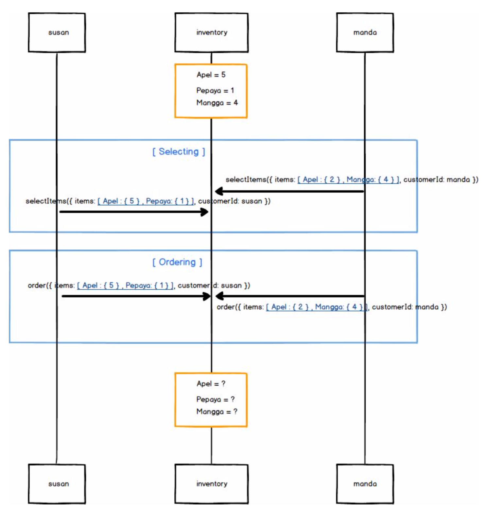

# order-lock

[](https://github.com/hendisantika/order-lock/actions/workflows/maven.yml)


Demo of handling concurrent orders with **JPA optimistic locking** (`@Version`) and **pessimistic locking**
(`SELECT ... FOR UPDATE`) in Spring Boot.

### Use Case
1. (Selecting) As a customer I can select item which I want, if stock is available
2. (Ordering) As a customer I can order items which I've already selected if stock is available

Situations which must be handled
1. Susan and Manda are ordering apple concurrently
2. Apple stock = 5, how do you serve Susan and Manda's orders?



### How it works
The `Product` entity has a `version` column annotated with `@Version`. Every update runs
`UPDATE ... SET version = version + 1 WHERE id = ? AND version = ?`.
When two customers read the same version and both try to save, the first save wins and bumps the
version; the second save matches zero rows and Hibernate throws an
`ObjectOptimisticLockingFailureException`, so stale data never overwrites a newer stock value.

### Pessimistic vs Optimistic Locking
Both strategies prevent the **lost update** problem (two transactions read the same row, both modify it,
and the last write silently overwrites the first). They differ in *when* the conflict is handled.

#### Pessimistic Locking
"Assume a conflict **will** happen, so lock first."

- The row is locked in the database when it is read (`SELECT ... FOR UPDATE`).
- Other transactions that want the same row must **wait** until the lock is released (commit/rollback).
- In Spring Data JPA:

    ```java
    @Lock(LockModeType.PESSIMISTIC_WRITE)
    @Query("SELECT p FROM Product p WHERE p.id = :id")
    Optional<Product> findByIdForUpdate(@Param("id") Long id);
    ```

- ✅ No conflict errors, the update always succeeds once the lock is obtained.
- ❌ Lower throughput: transactions queue up, locks are held for the whole transaction.
- ❌ Risk of deadlocks and lock timeouts; needs an open transaction (cannot span an HTTP request / user think time).

#### Optimistic Locking
"Assume a conflict **rarely** happens, so check at write time." (used in this project)

- No database lock when reading. Each row carries a `version` column (`@Version`).
- On update, the version is checked: `UPDATE ... WHERE id = ? AND version = ?`.
- If another transaction already changed the row, zero rows are updated and an
  `OptimisticLockException` / `ObjectOptimisticLockingFailureException` is thrown. The application then
  retries or tells the user that the data has changed.
- ✅ High throughput, no waiting, no deadlocks.
- ✅ Works across requests (the client sends back the `version` it read), ideal for REST APIs.
- ❌ Under heavy contention many requests fail and must be retried.

#### Comparison
| Aspect                 | Pessimistic Locking                      | Optimistic Locking                         |
|------------------------|------------------------------------------|--------------------------------------------|
| When conflict handled  | Before the update (lock on read)         | At commit time (version check)             |
| Mechanism              | `SELECT ... FOR UPDATE` (DB row lock)    | `@Version` column                          |
| Concurrent readers     | Blocked / waiting                        | Not blocked                                |
| On conflict            | Waits for the lock                       | Exception, then retry or reject            |
| Deadlock risk          | Yes                                      | No                                         |
| Scalability            | Lower                                    | Higher                                     |
| Spans multiple requests| No                                       | Yes                                        |
| Best for               | High contention, short critical sections | Low–medium contention, read-heavy systems  |

#### Which one is recommended?
**Optimistic locking is the recommended default**, and it is what this project uses, because:

1. Most of the time customers do not update exactly the same row at exactly the same moment, so
   conflicts are rare and paying the cost of locks on every read is wasteful.
2. It scales better and has no deadlock risk.
3. It fits stateless REST APIs: the `version` travels with the data between `GET` and `PUT`.

Use **pessimistic locking** instead when contention on the same row is **high** and retrying is
expensive or unacceptable, for example a flash sale where thousands of users buy the same item, seat or
ticket booking, or decrementing an account balance. In that case keep the transaction as short as possible
and set a lock timeout (`jakarta.persistence.lock.timeout`).

#### Pessimistic locking example in this project
- `ProductsRepository#findByIdForUpdate` uses `@Lock(LockModeType.PESSIMISTIC_WRITE)` with a 3 second lock timeout.
- `OrderService#order` runs in one `@Transactional` method: lock the row, check the stock, decrement it.
  The lock is released on commit, so concurrent orders for the same product are served one by one.
- Endpoint: `POST /products/{id}/order?quantity=1` returns `200` with the updated product,
  `409 Conflict` when the stock is not enough, `404` when the product does not exist and `400` when
  `quantity <= 0`.
- `OrderServicePessimisticLockTest` fires 10 concurrent orders at a product with stock 5:
  exactly 5 succeed, 5 get out of stock and the final stock is `0` (never negative).

> Tip: with optimistic locking, handle the exception gracefully, e.g. return `409 Conflict` to the
> client or retry automatically (Spring Retry `@Retryable`) for a few attempts.

### Tech Stack
| Component    | Version           |
|--------------|-------------------|
| Java         | 25                |
| Spring Boot  | 4.2.0             |
| Maven        | 3.9.11 (wrapper)  |
| Database     | H2 (in-memory)    |
| Others       | Spring Data JPA, Lombok |

### Prerequisites
- JDK 25
- Python 3 + [`requests`](https://pypi.org/project/requests/) (`pip install requests`) to run the test script
- Maven is optional, the project ships with the Maven Wrapper (`./mvnw`)

### Things to do to run this project
1. Clone this repo: `git clone https://github.com/hendisantika/order-lock.git`
2. Go to the folder itself: `cd order-lock`
3. Build & run the tests: `./mvnw clean verify`
4. Run the app: `./mvnw spring-boot:run`

    ```
      .   ____          _            __ _ _
     /\\ / ___'_ __ _ _(_)_ __  __ _ \ \ \ \
    ( ( )\___ | '_ | '_| | '_ \/ _` | \ \ \ \
     \\/  ___)| |_)| | | | | || (_| |  ) ) ) )
      '  |____| .__|_| |_|_| |_\__, | / / / /
     =========|_|==============|___/=/_/_/_/

     :: Spring Boot ::                (v4.2.0)

    ... Starting OrderLockApplication using Java 25 ...
    ... Tomcat started on port 8080 (http) with context path '/'
    ... Started OrderLockApplication in 1.576 seconds
    ```

   > Port 8080 already in use? Run `./mvnw spring-boot:run -Dspring-boot.run.arguments=--server.port=18080`
   > and call the script with `BASE_URL=http://localhost:18080`.

5. Open a new terminal to test the app.
6. Run the script: `python3 test-order.py`

    ```
    User A get: {'id': 1, 'name': 'Apple', 'stock': 5, 'version': 1}
    User B get: {'id': 1, 'name': 'Apple', 'stock': 5, 'version': 1}
    User B save: 200 {'id': 1, 'name': 'Apple', 'stock': 4, 'version': 2}
    User A save: 500 {'timestamp': '...', 'status': 500, 'error': 'Internal Server Error', 'path': '/products'}
    ```

   User B (Manda) saves first and the version goes from `1` to `2`. User A (Susan) still holds version `1`,
   so her update is rejected by optimistic locking instead of silently overwriting Manda's order.

7. Run the pessimistic locking script: `python3 test-order-pessimistic.py`

    ```
    Before: {'id': 2, 'name': 'Orange', 'stock': 4, 'version': 2}
    Customer 1 order: 409
    Customer 2 order: 409
    Customer 3 order: 200
    Customer 4 order: 200
    Customer 5 order: 409
    Customer 6 order: 200
    Customer 7 order: 200
    Customer 8 order: 409
    After: {'id': 2, 'name': 'Orange', 'stock': 0, 'version': 6}
    ```

   8 customers order 1 Orange (stock 4) at the same time. The row is locked with `SELECT ... FOR UPDATE`,
   so the orders wait for each other: exactly 4 succeed, the other 4 get `409 Conflict` (out of stock)
   and the stock never goes below `0`. Which customers win depends on timing.

### API Endpoints
| Method | Path             | Description                              |
|--------|------------------|------------------------------------------|
| GET    | `/products`      | List all products                        |
| GET    | `/products/{id}` | Get a product by id                      |
| PUT    | `/products`      | Update a product (must send `version`)   |
| POST   | `/products/{id}/order?quantity=1` | Order a product (pessimistic locking) |

Example with curl:
```shell
curl http://localhost:8080/products/1
curl -X PUT -H 'Content-Type: application/json' \
  -d '{"id":1,"name":"Apple","stock":4,"version":1}' \
  http://localhost:8080/products
curl -X POST "http://localhost:8080/products/1/order?quantity=2"
```

### H2 Console
Open http://localhost:8080/h2-console with JDBC URL `jdbc:h2:mem:order-lock`, username `sa` and an empty password.

### CI & Dependency Updates
- **GitHub Actions** builds and tests the project on JDK 25 (Temurin) for every push and pull request to `master`,
  then submits the Maven dependency graph to GitHub.
- **Dependabot** checks Maven dependencies daily and GitHub Actions weekly. Spring Boot updates, other
  minor/patch Maven updates and GitHub Actions updates are grouped into single pull requests.
